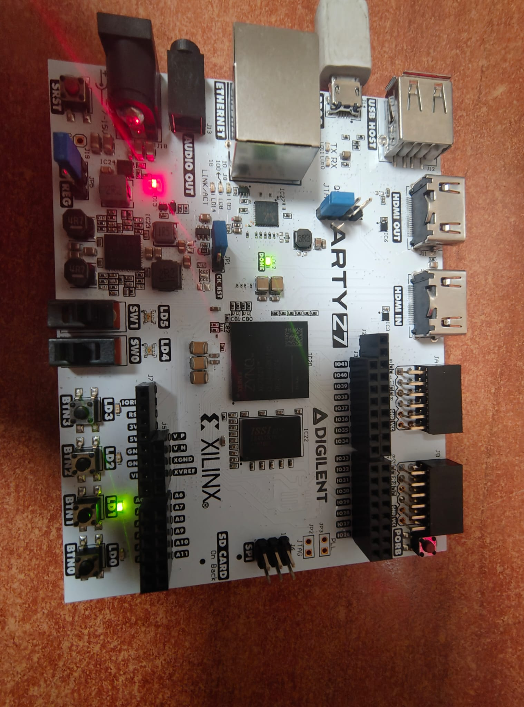
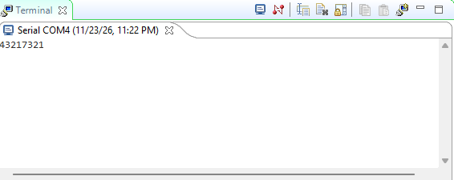
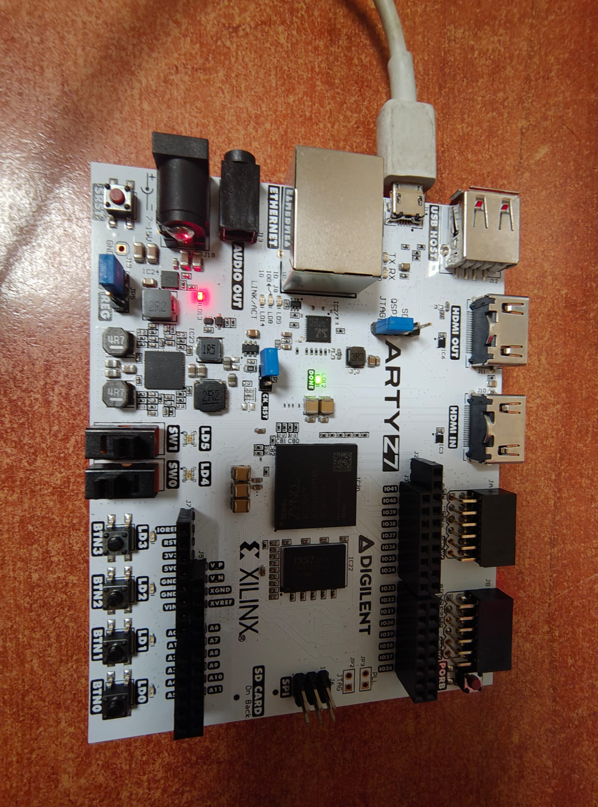
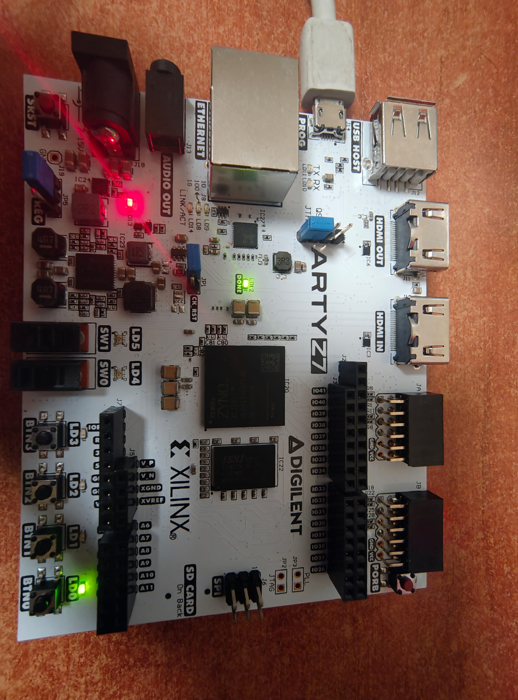
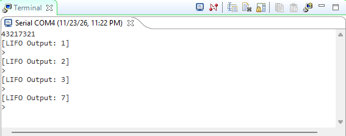
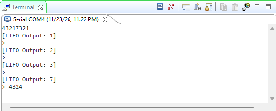

# UART-Controlled Hardware LIFO Buffer on Zynq-7000


A hardware/software co-design project implementing a custom 8-byte Last-In, First-Out (LIFO) stack in Programmable Logic (PL) interfaced with the Zynq-7000 Processing System (PS) over an internal EMIO UART bridge. Characters typed into a host PC serial terminal are pushed onto the hardware stack in real time and popped back to the terminal via physical pushbuttons on the FPGA board.

---

## Project Overview & Design Objectives

This project demonstrates end-to-end **PS–PL hardware/software integration** on a Zynq-7000 SoC without relying on AXI DMA or AXI-Stream wrappers—instead bridging a custom VHDL serial datapath directly to the ARM Cortex-A9 processor via routed EMIO UART pins:

* **Custom RTL Serial Engine:** Implements full-duplex UART RX/TX controllers from scratch in VHDL (`115200 bps`, `8N1`) driven by a `125 MHz` PL fabric clock (`clk_per_bit = 1085`).
* **Synchronous Hardware LIFO Stack:** Stores up to 8 bytes (`8 x 8-bit` register array) with single-cycle push/pop operations and real-time `full` / `empty` hardware status flags mapped to onboard LEDs.
* **Clock-Domain & Mechanical Input Conditioning:** Protects internal state machines against metastability and contact bounce using 2-flip-flop synchronizers on asynchronous inputs (`rx_serial`, `btn_read`, `btn_clear`) and a `10 ms` (`1,250,000`-cycle) digital debouncer with rising-edge pulse generation.
* **Bare-Metal C Bridge Firmware:** Runs a non-blocking polling loop on `ps7_cortexa9_0` (`XUartPs`) that forwards host PC keystrokes from `UART0` (MIO) to `UART1` (EMIO) and formats popped LIFO bytes back to the terminal.

---

## System Architecture

The design bridges a host PC to custom VHDL fabric logic using both UART controllers of the Zynq-7000 PS (`PS7`):

1. **PS UART0 (MIO 14..15):** Connects via the onboard USB-UART bridge to the host PC serial terminal.
2. **PS UART1 (EMIO):** Routed internally through the FPGA fabric to the custom `UART_RX_TX_LIFO_TOP` RTL module.
3. **PL Fabric (`UART_RX_TX_LIFO_TOP`):** Receives bytes serially from PS `UART1_TX`, pushes them into the synchronous `LIFO` memory, and transmits the popped byte back to PS `UART1_RX` when `BTN0` is pressed.

```text
+-------------+       USB-UART       +-----------------------------------------------+
|   Host PC   | <==================> |              Zynq-7000 SoC (PS7)              |
|  (Terminal) |    (MIO 14..15)      |                                               |
+-------------+                      |  +---------+     C Firmware     +---------+   |
                                     |  |  UART0  | <================> |  UART1  |   |
                                     |  +---------+   (helloworld.c)   +---------+   |
                                     +-----------------------------------+-----------+
                                                                         | EMIO
                                                                         v (115200 8N1)
+------------------------------------------------------------------------------------+
| Programmable Logic (PL) - 125 MHz FCLK_CLK0                                        |
|                                                                                    |
|   UART1_TX ---> [ UART_RX ] --(rx_valid / 8-bit)--> [    LIFO    ] ---> LED0 (full)|
|                                                     [ (8 x 8-bit)] ---> LED1 (empty|
|   UART1_RX <--- [ UART_TX ] <--(tx_start / 8-bit)-- [   Memory   ]                 |
|                                                        ^      ^                    |
+--------------------------------------------------------|------|--------------------+
                                                         |      |
                                                BTN0 (Read)    BTN1 (Clear)
```

---

## Hardware & Firmware Implementation Details

### 1. RTL Module Hierarchy (`/rtl`)
* **`UART_RX_TX_LIFO_TOP.vhd`:** Top-level PL wrapper instantiating the receiver, LIFO buffer, and transmitter. Synchronizes `btn_read` and `btn_clear` through 2-FF chains, debounces `btn_read` over `1,250,000` clock cycles (`10 ms` at `125 MHz`), and generates a single-cycle `read_pulse` gated by `(not empty_int) and (not tx_active)` so pops never underflow the stack or overwrite an active UART transmission.
* **`UART_RX.vhd`:** 5-state FSM (`idle -> start_check -> receive -> stop -> flag_stable`). Synchronizes `in_rx_serial` through 2 flip-flops, verifies the start bit at the mid-bit point (`542` cycles) to reject glitches, samples 8 LSB-first data bits every `1085` cycles, validates the stop bit (`r_rx_data = '1'`) to discard framing errors, and asserts `out_rx_valid` for one clock cycle.
* **`LIFO.vhd`:** Parameterized (`size = 8`) synchronous stack with stack pointer `index` (`0..8`). Asserts `write` on `rx_valid` to push `in_word` onto `lifo(index)`, asserts `read` on `read_pulse` to pop `lifo(index - 1)` onto `out_word`, and synchronously resets all entries and `index` when `clear = '1'`.
* **`UART_TX.vhd`:** 4-state FSM (`idle -> start -> transmit -> stop`) that latches `in_data` when `in_tx_start` pulses, serializes start (`0`), 8 data bits, and stop (`1`) at `1085` cycles/bit, and holds `out_tx_active = '1'` throughout transmission.

### 2. Bare-Metal Firmware (`/sw/src/helloworld.c`)
* Initializes both `XUartPs` instances (`UART0` and `UART1`) at `115200 bps` using `Xilinx standalone` drivers.
* Continuously polls `XUartPs_IsReceiveData()` on both interfaces in a non-blocking loop:
  * **Host -> PL:** Reads each incoming byte from `UART0`, echoes it back to the host terminal, and forwards it to `UART1` to trigger a hardware LIFO push.
  * **PL -> Host:** Reads popped bytes arriving on `UART1` from `UART_TX` and prints `[LIFO Output: <char>]` to `UART0`.

---

## Repository Structure

```text
├── constraints/       # Physical pinout and I/O standard constraints (.xdc)
├── hw/                # Exported Xilinx Support Archive (.xsa) for Vitis
├── rtl/               # Synthesizable VHDL source modules (UART RX/TX, LIFO, Top)
├── scripts/           # Vivado Tcl scripts for Block Design and project creation
├── sw/                # Vitis bare-metal C application source files
└── tb/                # VHDL testbenches for behavioral simulation
```

---

## Hardware & Software Requirements

* **Target Board:** Digilent Arty Z7-20 (`xc7z020clg400-1`, `digilentinc.com:arty-z7-20:part0:1.0`)
* **Toolchain:** Xilinx Vivado & Vitis `2022.2`
* **PL System Clock:** `125 MHz` (`FCLK_CLK0` generated by Zynq PS7)
* **Serial Terminal Configuration:** `115200 bps`, `8` data bits, `None` parity, `1` stop bit, `None` flow control

---

## Quick Start: Build & Run Guide

### 1. Generate Hardware & Bitstream (Vivado)
1. Open **Vivado 2022.2** (or run from a terminal with Vivado in your `PATH`):
   ```tcl
   vivado -mode batch -source scripts/build_project.tcl
   ```
   *(Alternatively, open Vivado GUI and run `source ./scripts/build_project.tcl` in the Tcl Console.)*
2. Open the generated project `vivado_proj/UART_RX_TX_LIFO.xpr` and click **Generate Bitstream** in the Flow Navigator.
3. Once implementation completes, select **File > Export > Export Hardware**, check **Include bitstream**, and save `design_1_wrapper.xsa` to `hw/`.

### 2. Build & Run Firmware (Vitis)
1. Launch **Vitis 2022.2** and select a short workspace directory (e.g., `C:\vitis_ws`).
2. Select **Create Application Project**, click **Create a new platform from hardware (XSA)**, and browse to `hw/design_1_wrapper.xsa`.
3. Name the application (e.g., `uart_lifo_app`), select the `standalone` domain on `ps7_cortexa9_0`, and choose the **Empty Application (C)** template.
4. Import all files from `sw/src/` (`helloworld.c`, `platform.c`, `platform.h`, `platform_config.h`) into the application's `src/` folder and press `Ctrl+B` to build.
5. Connect the Arty Z7-20 via USB, open a serial terminal at **115200 8N1**, and run **Run As > Launch Hardware**.

---
## Hardware & Simulation Results

### Live Board & Serial Terminal Demo

*Figure 1: Digilent Arty Z7-20 running the hardware LIFO design with LED status indicators.*


*Figure 2: Host PC terminal showing real-time character pushes and debounced BTN0 LIFO pops.*

### Vivado Block Design & Behavioral Simulation

*Figure 3: Zynq-7000 PS7 EMIO UART1 connected to the custom UART_RX_TX_LIFO_TOP RTL module.*


*Figure 4: Behavioral simulation verifying UART framing, LIFO stack pointers, and full/empty flags.*

## Hardware & Simulation Results








## Demo & Board Controls

Once the application starts, the terminal displays:
```text
Type characters into the terminal to push them to the LIFO
> 
```

| Action / Control | Board Pin | Behavior |
| :--- | :--- | :--- |
| **Type a character** | USB-UART | Echoes the character to the terminal and pushes the ASCII byte onto the LIFO stack. |
| **Press `BTN0`** | `D19` | Debounced rising-edge pop: removes the most recently pushed byte from the LIFO and prints `[LIFO Output: <char>]` in the terminal. Ignored if stack is empty or TX is busy. |
| **Press `BTN1`** | `D20` | Synchronously resets the LIFO stack pointer to `0` and clears all stored bytes. |
| **`LED0` On** | `R14` | Indicates `full = '1'` (all 8 stack slots are occupied; further pushes are ignored). |
| **`LED1` On** | `P14` | Indicates `empty = '1'` (0 bytes stored in the stack). |
